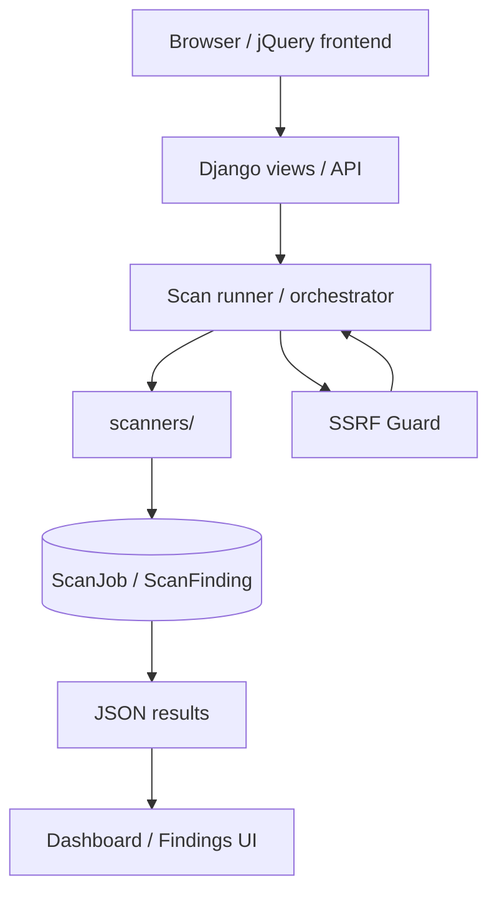

# Lilith

## Ethical Use & Disclaimer

Lilith is intended exclusively for security research, education, and authorized security assessments.

Only use Lilith against systems you own or systems for which you have explicit permission to perform security testing. Do not use the framework to gain unauthorized access, disrupt services, damage systems, or test third-party infrastructure without authorization.

The project and its examples are provided for legitimate security testing and educational purposes. Users are responsible for ensuring that their use of Lilith complies with applicable laws, organizational policies, and authorization requirements.

The author assumes no responsibility for misuse of the software or for actions performed outside an explicitly authorized testing scope.

Lilith is intended to support security awareness, vulnerability research, and secure software development.


**Web Security Assessment Framework**

Lilith is an open-source web security assessment framework designed for authorized security testing, research, and education. It focuses on evidence-aware findings, confidence-aware reporting, false-positive reduction, and clear OWASP/CWE/MITRE classification.

`Python 3.12` · `Django 5.0.4` · `Tests: 185 passing` · `License: MIT`

## Overview

Lilith runs a set of modular scanners against a single authorized target and aggregates their results into a unified, evidence-backed report. Rather than maximizing the raw number of findings, Lilith is built around distinguishing what was *observed* from what was *confirmed*, and reporting each finding with an explicit severity, confidence level, and operational status.

Scans run asynchronously through a small Django backend, and results are reviewed in a browser-based dashboard.

## Key Principles

Lilith's reporting model is built on a small set of consistent principles:

- **Accuracy over quantity.** A shorter list of well-supported findings is more useful than a long list of noisy ones.
- **Evidence over assumption.** A finding is only reported with the observed evidence that led to it — not because a pattern merely looks suspicious.
- **Confidence is not severity.** How strongly the evidence supports a finding is tracked separately from how serious that finding would be if true.
- **Potential is not confirmed.** Findings are only marked `CONFIRMED` when the available evidence justifies it; everything else is reported as `POTENTIAL`, `MANUAL_REVIEW`, or `INFORMATIONAL`.
- **An open port is not a vulnerability.** Discovery and exploitability are different claims, and Lilith does not conflate them.
- **A detected pattern is not a confirmed exploit.** Signature or heuristic matches are reported as indicators, not proof.
- **A missing header is not automatically high risk.** Header findings are scored based on realistic impact, not on the mere absence of a control.
- **Modern security guidance is preferred over deprecated controls** when the two disagree.
- **CWE/OWASP mapping is preferred over forcing a MITRE ATT&CK mapping** that would not add real context.
- **False-positive reduction is prioritized over aggressive detection.** Lilith would rather stay quiet than mislead.

## Features

### Web Application

- SQL Injection
- Cross-Site Scripting (XSS)
- OS Command Injection
- NoSQL Injection
- Access Control checks
- Authentication checks
- Software Integrity checks
- Error / Information Disclosure
- CMS / Technology Detection

### Network / Protocol

- Port Discovery
- TLS / SSL assessment
- DNS security checks

### HTTP

- HTTP Security Headers

Lilith reports *indicators* of these issues with explicit confidence and status metadata. It does not perform exploitation, and it only marks a finding as `CONFIRMED` where its detection method actually supports that conclusion (for example, reproducible time-based injection behavior). Most findings are intentionally reported as `POTENTIAL` or `MANUAL_REVIEW` pending human verification.

## Architecture



- **Django views/API** accept a target URL, validate it, and expose a small JSON API for starting scans and polling their status.
- **SSRF Guard** validates every scan target before any request is made, rejecting private/internal/metadata addresses and unsupported schemes.
- **Scan runner / orchestrator** starts each scanner concurrently against the target and isolates individual scanner failures so that one scanner's error does not drop the rest of the scan's results.
- **Scanners** are independent modules built on a shared `Scanner` base abstraction, each producing a list of `Finding` objects for its area (injection, headers, TLS, DNS, etc.).
- **ScanJob / ScanFinding** persist the scan's status and findings so results survive the async polling cycle.
- **Dashboard / Findings UI** is a server-rendered Django template with jQuery-driven AJAX polling — no separate frontend framework or build step.

## Finding Model

Every finding Lilith reports carries three independent pieces of metadata, deliberately kept separate:

| Field | Meaning | Values |
|---|---|---|
| **Severity** | The potential impact *if the finding is real*. | `INFO`, `LOW`, `MEDIUM`, `HIGH`, `CRITICAL` |
| **Confidence** | How strongly the available evidence supports the finding. | `LOW`, `MEDIUM`, `HIGH` |
| **Status** | How the finding should be interpreted operationally. | `CONFIRMED`, `POTENTIAL`, `INFORMATIONAL`, `SECURE`, `MANUAL_REVIEW` |

A finding can be high severity with low confidence (a serious issue that needs manual verification), or low severity with high confidence (a minor issue that is well-evidenced). Collapsing these into a single score would hide that distinction — Lilith keeps them separate so each can be reasoned about on its own.

Findings may also include OWASP and CWE classification, and a MITRE ATT&CK reference when one adds meaningful context. MITRE ATT&CK is not forced onto findings where it would not — it is omitted rather than mapped arbitrarily.

## Installation

Python 3.12 is recommended.

### Windows (PowerShell)

```powershell
python -m venv .venv
.\.venv\Scripts\Activate.ps1
python -m pip install --upgrade pip
pip install -r requirements.txt
Copy-Item .env.example .env
python ZafiyetTaramasi/manage.py migrate
python ZafiyetTaramasi/manage.py runserver
```

### Unix / macOS

```bash
python3 -m venv .venv
source .venv/bin/activate
python -m pip install --upgrade pip
pip install -r requirements.txt
cp .env.example .env
python ZafiyetTaramasi/manage.py migrate
python ZafiyetTaramasi/manage.py runserver
```

Then open **http://127.0.0.1:8000/**.

This setup is intended for local, development, and educational use. It has not been hardened for, and should not be treated as ready for, a public production deployment.

### Environment Variables

`.env.example` documents every variable the application reads. Copy it to `.env` and adjust as needed — never commit `.env` itself.

| Variable | Purpose |
|---|---|
| `DJANGO_SECRET_KEY` | Django's cryptographic signing key. Generate a real value for anything beyond local use. |
| `DJANGO_DEBUG` | Enables Django's debug mode. Keep `True` only for local development. |
| `DJANGO_ALLOWED_HOSTS` | Comma-separated hostnames allowed to serve the app when `DJANGO_DEBUG` is `False`. |

## Usage

1. Start Lilith locally.
2. Open the dashboard.
3. Enter an authorized target URL.
4. Run the assessment.
5. Wait for the full scan to complete.
6. Review the Overview, Findings, Web Application, Network, TLS & DNS, and technology/framework sections.
7. Use the severity, status, confidence, evidence, and recommendation fields together when analyzing results — no single field tells the whole story.

**Only scan systems you own or are explicitly authorized to assess.**

## Screenshots

Release screenshots will use authorized lab targets only.

## Project Structure

```
Proje/
├── requirements.txt
├── .env.example
├── README.md
├── SECURITY.md
├── LICENSE
├── static/
│   └── css/
│       └── lilith.css
├── templates/
│   └── base.html
└── ZafiyetTaramasi/
    ├── manage.py
    ├── ZafiyetTaramasi/
    └── Tarama/
        ├── scanners/
        ├── services/
        ├── migrations/
        ├── templates/
        ├── models.py
        ├── views.py
        ├── urls.py
        └── tests.py
```

## Security & Responsible Use

V1's security-relevant design choices:

- **SSRF protection.** Every scan target is validated before use, rejecting localhost, private/internal ranges, cloud metadata addresses, and unsupported schemes.
- **Sanitized error handling.** Unexpected internal exception details are not exposed through the API or frontend — the server-side log receives the full detail; the client receives a generic, sanitized message.
- **Untrusted output handling.** The frontend treats every scan-result string as untrusted data and renders evidence using safe text insertion rather than raw HTML.
- **Local-first data.** Scan results are stored locally in SQLite by default; nothing is sent to a third-party service.

Lilith has not undergone a formal third-party security audit. Treat it as a V1 open-source project, not an audited product.

Lilith is intended for security research, education, and authorized security assessments. Only scan systems you own or systems for which you have explicit permission to test. Users are responsible for ensuring their testing complies with applicable authorization, policy, and legal requirements.

## Testing

```bash
python ZafiyetTaramasi/manage.py check
python ZafiyetTaramasi/manage.py test Tarama --verbosity=1
```

V1 currently contains 185 automated tests, covering:

- scanner regression behavior
- injection false-positive cases
- the finding contract (severity/confidence/status/evidence)
- severity and status aggregation
- SSRF protection
- orchestrator failure isolation
- asynchronous scan persistence
- API contracts
- sensitive error leakage

## Current V1 Limitations

Lilith V1 is transparent about its current boundaries:

- DOM XSS detection is heuristic/static proximity analysis, not full data-flow analysis.
- RAWTEXT/RCDATA HTML contexts such as `<textarea>`, `<title>`, and `<style>` are not specially classified during XSS context detection.
- URL-parameter reproducibility validation for command and NoSQL injection is less extensive than the equivalent form-field paths.
- Baseline/timing helper logic is currently duplicated across several injection scanners rather than sharing a common module.
- V1 is intended primarily for local, educational, and authorized assessment workflows.
- No report export / PDF generation in V1.
- No user/account system.
- No scan-history UI in the public dashboard.

## Roadmap

### V1.x

- Scanner accuracy refinements
- UI/accessibility polish
- Better evidence normalization
- Improved documentation
- Optional report export

### V2

- Plugin/extensibility model
- Richer scan orchestration
- More structured reporting
- Expanded lab/testing environment support

No dates are promised for the above, and none of it changes V1's current scope.

## Contributing

1. Open an issue describing the change you'd like to make.
2. Keep scanner changes evidence-based — new detections should be grounded in observable, reproducible behavior.
3. Add or update regression tests for any scanner behavior you change.
4. Avoid changes that increase false-positive rates without supporting evidence.
5. Run the complete test suite before submitting a change.

## License

This project is licensed under the MIT License — see [LICENSE](LICENSE) for details.

Created and maintained by Hamza Bicer.
